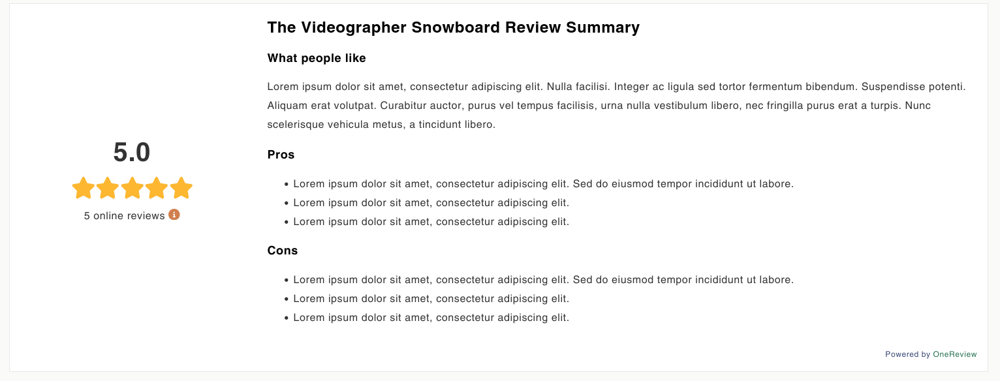
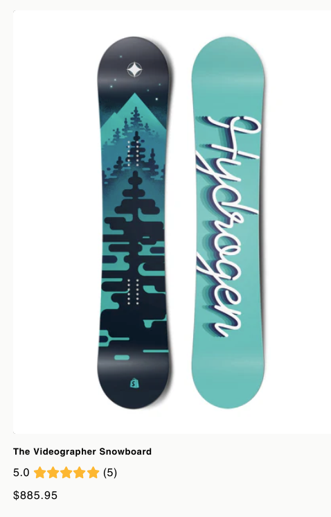

# shopify-components

Public repo for OneReview app block code, for custom implementations.

<!-- upstream-sync: 15391058a317c58217478a1878901bf9b451c942 -->

---

## Please read first

**This is a partial implementation.** The files here are a hand-maintained copy of the
OneReview theme app extension. They may be missing features that the app block has, and they can
lag behind the app.

**The recommended way to add OneReview to a storefront is the app block**, not this repo:

> Shopify admin → **Online Store** → **Themes** → **Customize** → **Add block** → **Review
> Summary** / **Star Rating** / **General stars**

The app block installs itself, updates itself when we ship changes, and is the version we support.

**Use this repo only for custom implementations** where the app block cannot be used — for example
a headless or heavily customised theme, or a section that does not accept app blocks.

These snippets are **not covered by automated tests**. They are checked by hand before each sync
(see [Verification](#verification)) but they do not get the same coverage as the app.

---

## Requirements

1. **The OneReview app must be installed on the store.** These files read the review data the app
   writes to your products, and the "General stars" component calls the app's storefront proxy at
   `/apps/onereview/ratings`. Without the app installed there is no data and nothing renders.
2. The products you want stars on must have a **published** OneReview summary.

You do **not** need to enable the app block for these files to work — installing the app is enough.

---

## What's in here

Synced from the OneReview app extension at commit
`15391058a317c58217478a1878901bf9b451c942`.

| File | Copy into your theme's | Notes |
| --- | --- | --- |
| `sections/onereview-review-summary.liquid` | `sections/` | Product page. Full review summary card. |
| `snippets/onereview-star-rating.liquid` | `snippets/` | Product page. Compact rating line. |
| `snippets/onereview-general-stars.liquid` | `snippets/` | Stars on product cards, anywhere. |
| `snippets/onereview-stars.liquid` | `snippets/` | Shared helper. Required by the two above it. |
| `assets/onereview-summary.css` | `assets/` | |
| `assets/onereview-star-rating.css` | `assets/` | |
| `assets/onereview-star-rating.js` | `assets/` | |
| `assets/onereview-general-stars.css` | `assets/` | |
| `assets/onereview-general-stars.js` | `assets/` | **Generated** — see below. |
| `assets/onereview-icon.svg` | `assets/` | OneReview logo for the "Powered by" link. |

Each `.liquid` file loads the CSS and JS it needs, so there is nothing to add to `theme.liquid`.

### onereview-review-summary.liquid

- Goes on a product template.
- Depends on `onereview-stars.liquid`.
- Every option (colours, dropshadow, headings) is editable in the theme editor.



### onereview-star-rating.liquid

- Goes on a product template.
- Depends on `onereview-stars.liquid`.


### onereview-general-stars.liquid

- Adds stars to product cards on collection, search, home and product pages, including
  recommendation carousels and lazy-loaded/AJAX-filtered grids.
- Render it **once per page**. It covers every product card on the page from that one include.



### onereview-stars.liquid

- Shared helper that draws five stars for a rating. Not used on its own.


---

## Steps for installation

1. In the Shopify admin, go to **Online Store → Themes → ⋯ → Edit code**.

2. Create these files in the **`assets`** folder and paste in the matching file from this repo:

   - `onereview-summary.css`
   - `onereview-star-rating.css`
   - `onereview-star-rating.js`
   - `onereview-general-stars.css`
   - `onereview-general-stars.js`
   - `onereview-icon.svg`

3. Create these files in the **`snippets`** folder and paste in the matching file from this repo:

   - `onereview-stars.liquid`
   - `onereview-star-rating.liquid`
   - `onereview-general-stars.liquid`

4. Create this file in the **`sections`** folder and paste in the matching file from this repo:

   - `onereview-review-summary.liquid`

5. On the product template, add the star rating where you want it to appear:

   ```liquid
   
   ```

6. On the product template, add the review summary where you want it to appear:

   ```liquid
   
   ```

   Its colours and headings are then editable under **Customize** in the theme editor. On a
   JSON template you can instead add it from **Add section → OneReview Review Summary**.

7. To show stars on product cards, add this **once** near the bottom of each template that lists
   products (collection, search, index, and the product template if it has a recommendations
   carousel):

   ```liquid
   
   ```

   Adding it more than once on the same page will not work — it emits an element with a fixed id.

8. Publish, then load a product with a published OneReview summary to confirm it renders.

### Options

The section's options are in the theme editor. The two snippets take their options as `render`
parameters, with the same names and defaults as the app block:

```liquid



```

`custom_class_to_insert_block` is the class of the element in each product card that the stars are
inserted before. It defaults to `price`, which works on most themes; change it only if OneReview
support asks you to.

To restyle anything, edit the CSS files in `assets/`.

---

## Upgrading from a previous version of this repo

The layout changed to match a Shopify theme, and the collection/search/home snippets were merged
into one. If you installed an earlier version:

1. Delete these from your theme's `snippets` folder — they no longer exist here and the code that
   backed them has been replaced:
   - `onereview-collection-stars.liquid`
   - `onereview-search-stars.liquid`
   - `onereview-home-stars.liquid`
   - `onereview-css.liquid`
2. Remove any `` calls to them from your templates, and remove
   `` from `theme.liquid` — each component now loads its own CSS.
3. Move `onereview-review-summary.liquid` to the `sections` folder if it is not already there.
4. Follow the installation steps above, then add `` once per
   product-listing template in place of the three snippets you removed.

The previous collection, search and home star snippets did not render (they had two code bugs);
both are fixed in this version. If you saw no stars on your collection or search pages before, this
upgrade is the fix.

---

## Known limitations vs the app block

The rendered output of each component now matches the app block. What you give up by using this
repo instead:

- **No automated tests and no automatic updates.** The app block is versioned and updated by the
  app; these files are copied by hand and will lag whenever the app ships a change. Re-sync by
  comparing against the commit recorded at the top of this file.
- **The two snippets have no theme-editor UI.** `onereview-star-rating` and
  `onereview-general-stars` are configured by editing `render` parameters in your template code,
  not by clicking in **Customize**. The `onereview-review-summary` section does have the full
  theme-editor UI, matching the app block.
- **Placement is manual.** With the app block you drag the component into a section and see it move
  live. Here you edit the template and pick the insertion point yourself.
- **Colour options are plain CSS colour strings**, not Shopify colour pickers, so there is no
  colour-picker UI and no transparency handling.
- **`assets/onereview-general-stars.js` is generated** and must not be hand-edited (see below).
- If you enable the star rating tooltip, the snippet also loads `onereview-summary.css`, because
  the tooltip styles live there. That is a slightly larger CSS payload than the app block loads for
  the star rating on its own.

Everything else is at parity: `onereview-stars.liquid` and all six `assets/` files are byte-for-byte
identical to the app's, the review summary has all ten of the app block's settings, the star rating
has the custom text / tooltip / tooltip position / star colour options, and the general stars
component includes the app-proxy lookup that covers home pages, carousels and AJAX-loaded grids.

---

## About `assets/onereview-general-stars.js`

This file is **generated** — do not edit it. Edits will be overwritten the next time this repo is
synced, and there is no build tooling here to regenerate it from a modified source.

It is built with esbuild from the app repo (private):

- source: `tools/extensions/onereview-summary/general-stars.src.js` and `stars-helpers.js`
- build: `esbuild general-stars.src.js --bundle --minify --target=es2017`

The copy here is the app's built output with the trailing `sourceMappingURL` comment removed, since
the source map is not published.

## Verification

There is no CI in this repo. Before each sync the components are checked by hand:

- `shopify theme check` (the config in `.theme-check.yml` mirrors the app's) — clean.
- Every `.liquid` file rendered against collection, search, home, product and theme-editor contexts,
  with the emitted `#OneReviewData` blob parsed as JSON.
- The built `onereview-general-stars.js` run against a simulated product grid to confirm stars are
  injected and that unknown handles fall through to the app proxy.

## Support

<support@onereview.app>
